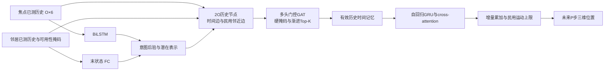

# 民用交互场景与论文结构对齐（v0.4）

这一扩展使用低速行人/小车在固定路线上的交叉、合流、共用通道、坡道交叉、优先通行变化和分离通行对照。通行规则生成双实体轨迹；模型进行离线监督预测，不控制参与者。两个参与者都有各自固定目的地，不设置追逐、拦截或逃逸目标。

## 对齐和适配

| 论文通用组件 | 本次实现 | 明确差异 |
|---|---|---|
| 式12–14：历史BiLSTM与外部状态FC融合 | 焦点历史BiLSTM + 已测邻居末状态FC + 后验/context | 邻居用相同局部坐标系的6维位置/速度；多个邻居可用状态取均值，未观测时置零 |
| 式15–16：两条实体时间线 | 焦点O节点、一个邻居O节点，总计2O；实体标签嵌入 | 学习场景为民用低速通行；仅预测焦点未来位置 |
| 时序和空间边 | 同实体时间半径内边 + 同步且距离半径内跨实体边 | 时序半径不只包含相邻一步；不构造原文专用对抗边 |
| 门控、阻断、Top-K与渐进裁剪 | 7维位置差/速度差/时间差边特征；观测可用性、历史运动一致性、空间半径；门控与Top-K调度 | 可用性由数据mask给定；不计算视线、拦截几何或专用风险 |
| 时序记忆、自回归GRU与cross-attention | 有效双方历史进入时序记忆；焦点历史记忆初始化GRU，预测累加到末位置 | 静态FC和全局时间/cross-attention可读全部有效邻居；空间半径仅限制GAT跨实体边 |
| 独立分类预训练与冻结迁移 | 同数据、dt、观察段、归一化及整场景划分的两阶段训练 | 原论文不同采样协议由独立配置表达，不跨协议直接迁移 |
| 因素消融 | I/C四格：+I+C、-I+C、+I-C、-I-C；保留民用教师T | C为民用已测邻居信息；不等同于原文E；原有I/T消融仍可用 |
| 在线滚动、ADE/FDE与e(t) | 每步接收双方实测状态，刷新预测；整场景bootstrap、分场景误差、可见近邻子集误差、图表 | 数据集和参数属于民用适配，不能与论文结果表数值比较 |

`context_entities=1`时，完整配置为d256、6个独立64维图头、2图层、2时间层、4时间头、自回归GRU、Top-K8、温度.1。`paper_interaction.json`使用dt=.1/O80/P60，对齐论文预测采样协议；`server_interaction.json`为dt=.5/O20/P12；`cpu_interaction.json`缩小结构用于本机调试。



## 数据协议与泄漏防护

原NPZ格式不变，新增数组：`scene_id[R]`、`scenario[R]`、`context_states[R,N,6]`、`context_mask[R,N]`。存在邻居历史时必须显式提供非空`scene_id`；无邻居的独立轨迹仍可省略，采用track_id分组。同场景成员的scenario分类必须一致。所有实体采用同步等间隔时间戳；`context_mask=false`表示当前邻居测量不可用，加载时填零。可用测量必须有限。CSV使用`scene_id,scenario,context_0_x,...,context_0_vz,context_0_mask`等列，索引从0连续；mask为0时状态允许留空。

每个参与者仍有独立track_id，但共享scene_id。同场景全部成员进入同一数据分区；训练和恢复都验证这一点。归一化仅拟合训练窗口内有效的双方历史，双方使用焦点末位置/朝向的共同坐标系。I/C消融复用同一归一化和冻结分类器；关闭C时图仅包含焦点历史，静态邻居输入置零，不依赖任何邻居测量值。

当前仿真每场景输出两条焦点轨迹，分别以另一条为邻居。场景类型、计划路线、未来状态、通行优先级和等待统计均不进入网络。标签仍为从已测运动推导的九种方向类别，窗口只在观察段多数表决。标签并非“让行/抢行”的策略分类；类支持不均衡，应同时查看宏F1、支持数和多数类比例。

教师仍为民用历史平滑、速度一致和时间邻近。时间索引在各实体内部重置，差分不跨实体边界，缺测相邻对不计算加速度；无效查询行不参与KL/熵/抖动/分离监督。训练损失不使用其他实体未来轨迹、计划路线或通行优先级。

## 本机完整流程

从仓库根目录执行，输出目录/文件需为新路径：

```powershell
$py = ".venv/Scripts/python.exe"
$entry = "xuance-master/Trajectory Prediction/run.py"
$cfg = "xuance-master/Trajectory Prediction/configs/cpu_interaction.json"
& $py $entry simulate --output "xuance-master/outputs/trajectory/pairs01/data.npz" --scenes 36 --steps 80 --dt .5 --measurement-dropout .05
& $py $entry check --data "xuance-master/outputs/trajectory/pairs01/data.npz" --config $cfg --device cpu --backward
& $py $entry pipeline --data "xuance-master/outputs/trajectory/pairs01/data.npz" --config $cfg --output "xuance-master/outputs/trajectory/pairs01/pipeline" --intention-epochs 3 --device cpu
& $py $entry rolling-evaluate --data "xuance-master/outputs/trajectory/pairs01/data.npz" --checkpoint "xuance-master/outputs/trajectory/pairs01/pipeline/forecast/best.pt" --output "xuance-master/outputs/trajectory/pairs01/rolling" --device cpu --refresh-steps 1
& $py $entry compare --data "xuance-master/outputs/trajectory/pairs01/data.npz" --config $cfg --output "xuance-master/outputs/trajectory/pairs01/comparison" --epochs 2 --intention-epochs 3 --seeds 42,43 --models graph,lstm,gru,tcn,transformer,graph_no_intention,graph_no_context,graph_no_intention_context --device cpu
& $py $entry report --comparison "xuance-master/outputs/trajectory/pairs01/comparison" --data "xuance-master/outputs/trajectory/pairs01/data.npz" --output "xuance-master/outputs/trajectory/pairs01/figures" --device cpu
```

`compare`的图模型读双方已测历史，四序列基线只读焦点历史；`graph_no_context`提供图结构的纯焦点对照。分类成本独立记录，预测轮数一致。旧I/T消融`graph_no_attention_supervision`、`graph_no_both`可追加运行，不能和I/C因素命名混淆。

## 输入实时测量和原生Xuance

```python
from trajectory_prediction.inference import Predictor
from trajectory_prediction.rolling import RollingPredictor

predictor = Predictor("/absolute/path/forecast/best.pt", "cpu")
result = predictor.predict(focal_history, peer_history, peer_mask)
# focal_history [O,6]，peer_history [N,O,6]，peer_mask [N,O]
stream = RollingPredictor(predictor, refresh_steps=1)
result = stream.push(timestamp, focal_state, peer_states, peer_available)
# 当前状态分别为[6]和[N,6]；可用性[N]。缺测时传全零状态和false mask。
# O个同步测量前返回None。换场景必须reset；预测不会反馈成新测量。
```

原生入口支持`get_runner(algo="trajectory_prediction", env="civilian_trajectory", env_id="paired_scene", parser_args=...)`，传`trajectory_config`或`trajectory_overrides`选择配置。原生Agent的`predict`也接受以上三组历史输入。Xuance Runner/Policy/Learner注册与资源清理流程均沿用既有接入。

## 服务器实验矩阵

安装环境和打包沿用README。新的脚本默认使用完整dt=.1配置、三个独立数据种子、三个初始化种子、每库60个场景/320步、八模型：

```bash
bash xuance-master/bash/run_civilian_interaction.sh /absolute/path/pair_study cuda:0
# 同一参数继续：
bash xuance-master/bash/run_civilian_interaction.sh /absolute/path/pair_study cuda:0 "xuance-master/Trajectory Prediction/configs/paper_interaction.json" --resume
```

可配置`TRAJECTORY_STUDY_SCENES`、`TRAJECTORY_STUDY_STEPS`、`TRAJECTORY_DATA_SEEDS`、`TRAJECTORY_MODEL_SEEDS`、`TRAJECTORY_INTENTION_EPOCHS`；初次训练前确定规模和采样协议。显存不足时为新实验降低batch_size，保持结构参数。Linux/CUDA/AMP仍需服务器实测。

直接使用`study --data-mode civilian_interaction --scenes ...`也可生成独立场景库。层次bootstrap重采样“库种子→初始化种子”；单次评估的bootstrap重采样完整scene，不能将两个同场景轨迹当成两个独立重复。

输出另含逐场景、逐场景类型、观察段出现可见近邻/未出现近邻的ADE/FDE与恒速对照。近邻条件只取观察段、可用性mask和配置空间半径，不取未来真值。仿真metadata记录最小实际间距及低于.75m的比例，属于数据诊断；不保证真实避碰控制性能，不以这些统计优化预测模型。

这是民用交互结构适配，未重现原文专用交互因素、原始场景或结果。短CPU训练和小样本区间仅验证代码流程。

## 已完成的本机证据

实际输出为`../outputs/trajectory/interaction_v04/`：36场景主实验、16次八方法比较、588窗口逐步滚动及两个独立场景库。`coverage/`另有60场景的独立实验，在训练前只按场景类别检查覆盖，固定split_seed=1；其9个测试场景覆盖全部六类，共234窗口。主实验划分和结果未改变。两套最终图表分别位于`figures_release/`和`coverage/figures_release/`。

该覆盖实验完成了6类通行场景的测试流程，但观察窗口只支持直行/上行两类标签，不构成九类平衡识别实验。全部数值、支持数、CPU测试和服务器演练见 [VALIDATION.md](VALIDATION.md) 的v0.4节；交付机器记录为`../outputs/trajectory/interaction_validation_v04.json`。
